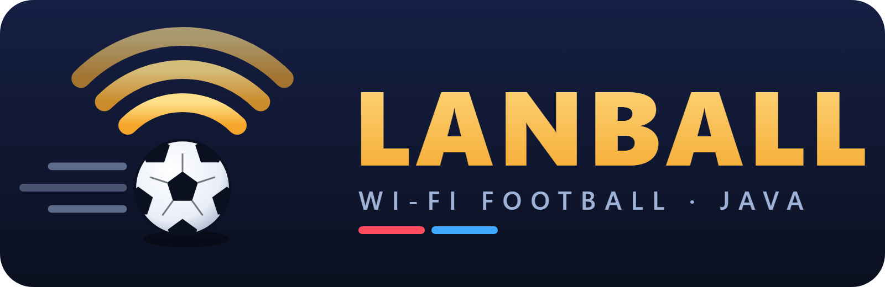
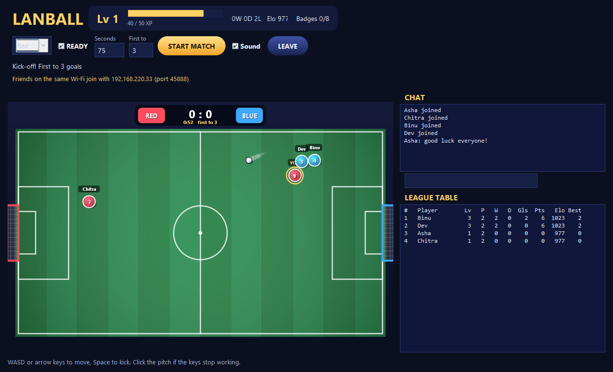

# LanBall 7.1: Wi-Fi football in plain Java Swing

LanBall is a 2-6 player football game for computers on the same Wi-Fi or LAN. One computer hosts; the others join its IP address.
v7 is the v6 game (sounds, effects, levels, badges) rebuilt under the PBCST304 rule: **use only what the KTU Special OOP notes
teach** (Modules 1-4). It needs **only a JDK or JRE, Java 8 or newer**. No Maven, no JavaFX, no extra libraries.

**Size: 999 Java lines** (limit 1000) in 4 files: `Server.java` 373, `LanBall.java` 325, `Pitch.java` 232, `Sound.java` 69.

## What is new in 7.1

- **Corner physics fixed.** The ball no longer zig-zags when two players pin it against a wall or into a corner.
  A touch now pushes the ball out by the overlap and bounces it off the moving player; a wall turns only a ball that moves
  into it; a ball squeezed between two players stops; a pinned ball loses its speed. Direction flips in a 120-tick squeeze: 68 → 0.
- **LEAVE fixed.** An old snapshot that arrived just before LEAVE could put the screen back into the finished match. It is now dropped.
- **Linux and macOS scripts:** `run.sh` and `build.sh`. Fedora guide: [docs/FEDORA_SETUP.md](docs/FEDORA_SETUP.md).
- **Logo** in `docs/logo`, real gameplay images in `docs/screenshots`, and the test programs in [`tests/`](tests/README.md).

## Run it

- **Windows:** double-click `run.bat`. **Linux / macOS:** `sh run.sh`. Or anywhere: `java -jar LanBall-v7.jar`.
- To rebuild after you change the code: `build.bat` (Windows) or `sh build.sh` (Linux / macOS).
- Saved players and matches go in `lanball-v4-data` next to the JAR. Earlier versions used the same folder and file formats.
  To use another folder: `java -Dlanball.data=myfolder -jar LanBall-v7.jar`.

**How to play**
1. Fill in Player name, PIN (6-12 digits), Club and Shirt. Keep "Create profile" ticked the first time.
2. One player clicks **HOST**. The window then shows the address the others must type (port 45888).
3. The others type that address in Host IP and click **JOIN**.
4. Each player chooses Red, Blue or Watch, then ticks **READY**. The host clicks **START MATCH**.
5. Move with WASD or the arrow keys. Kick with Space. If the keys stop working, click the pitch.

## The notes rule

The team agreed this rule: the **Java language** in this code is limited to what the notes teach. The code also uses **library classes**
from the packages that the notes name (`java.net`, `java.io`, `javax.swing`, `java.awt`). The table below lists each one and why it is necessary.

### Language: where each construct is taught

| Construct used | Notes module and topic | Where in the code |
|---|---|---|
| Primitive types, casting, wrapper classes (`Integer.parseInt`) | M1: data types, casting, wrappers | everywhere; `(int) ballX`, `(short)` in Sound |
| 1-D and 2-D arrays, anonymous arrays, for-each | M1: arrays | `int[][] rows` in `Server.addResult`, `new float[]{0, 1}` in Pitch |
| `String` methods, `Vector<T>`, `Iterator`-style loops | M1: strings, Vector class | `Vector<Player>`, `Vector<Profile>`, chat lines |
| Operators: bitwise `& \| ~ <<`, ternary, `++` | M1: operators | input bits (left 1, right 2, up 4, down 8, kick 16, ready 32), badge bits |
| `if`, `switch` with `break` and fall-through, `while`, `for`, `continue`, `return` | M1: control statements | `LanBall.bit` (key switch), `Sound.synthesize` |
| Varargs `Component... parts` | M1: varargs | `LanBall.row`, `LanBall.column`, `Card` |
| Classes, objects, constructors, `this` | M2: objects, constructors, `this` | every class; `this.socket = socket` |
| Objects as parameters, returning objects | M2: objects as parameters, returning objects | `stats(name)` returns a `Profile` |
| `static` variables, methods; `final` and blank `final` | M2: static, final | `Server.PORT`, `final JPanel connection` set in the constructor |
| Inner classes | M2: inner classes | `Server.Acceptor`, `Server.Connection`, `LanBall.Link`, `Pitch.Body` |
| Inheritance, `extends`, `super(...)`, overriding | M2: inheritance, `super`, overriding | `Pitch extends JPanel`, `GameButton extends JButton` overrides `paintComponent` |
| Dynamic method dispatch | M2: dynamic dispatch | Swing calls our `paintComponent` through a `JComponent` reference |
| Packages, `import`, access modifiers | M3: packages, access protection | `package lanball;`, `public`/`protected`/default members |
| Interfaces, `implements`, many interfaces | M3: interfaces | `LanBall implements ActionListener, KeyListener, FocusListener, MouseListener`; `Runnable` |
| `try`, many `catch`, `finally`, `throw`, `throws` | M3: exceptions | `Server.read` (finally closes the file), `Connection.run` |
| Checked and unchecked exceptions; custom exception | M3: custom exceptions | `LoginException extends Exception` |
| Swing controls: JFrame, JPanel, JLabel, JButton, JTextField, JPasswordField, JCheckBox, JComboBox, JTextArea, JScrollPane | M4: Swing controls | `LanBall` constructor |
| Layout managers: BorderLayout, FlowLayout, GridLayout, BoxLayout | M4: layout managers | `content`, `row`, `xpBox`, `column` |
| Delegation event model: source, listener, register, handle | M4: event handling | `addActionListener(this)`, `actionPerformed` checks `e.getSource()` |
| `synchronized` | M1: the non-access modifier list | methods that the network thread and the window both use |

Not used, because the notes do not teach them: lambdas, anonymous classes, enums, records, `var`, streams, `switch ->`,
try-with-resources, multi-catch, `instanceof` patterns, `HashMap`. One construct goes slightly past the notes: the
`(Graphics2D) graphics` cast. The notes show casting for primitives and upcasting; this is the matching downcast.

### Library classes outside the notes (agreed)

| Class | Package (named in the notes?) | Why it is necessary |
|---|---|---|
| `Socket`, `ServerSocket`, `DataInputStream`, `DataOutputStream` | `java.net`, `java.io` (yes, M3 list) | the LAN connection |
| `Thread` (with our `Runnable` classes) | `java.lang` | the host runs players, the clock and the listener at the same time |
| `File`, `FileReader`, `BufferedReader`, `FileWriter` | `java.io` (yes) | saves profiles and match results |
| `javax.swing.Timer` | `javax.swing` (yes) | redraws about 60 times a second; it calls `actionPerformed` |
| `Graphics2D`, `GradientPaint`, `RadialGradientPaint`, `Ellipse2D` | `java.awt` (yes, with AWT) | draws the pitch, players and effects |
| `Clip`, `AudioSystem`, `AudioFormat` | `javax.sound.sampled` (no) | plays the sounds |
| `MessageDigest`, `SecretKeyFactory`, `PBEKeySpec`, `Base64` | `java.security`, `javax.crypto`, `java.util` (no) | PIN login without sending the PIN |
| `FileLock`, `StandardCharsets`, `NetworkInterface` | `java.nio`, `java.net` | one host per data folder; show the host's IP address |

## What 7.1 has

- **Game look:** night-stadium theme, striped floodlit pitch, goal nets in team colours, gradient players with shadows, a ball trail,
  a pulsing gold ring on your own player, name tags with one dot per goal, rounded gold buttons.
- **Moments:** 3-2-1 kick-off countdown, goal banner, confetti, screen shake and flash on a goal, a VICTORY / DEFEAT / DRAW screen
  with the XP you earned, and "Tick READY for a rematch".
- **Sounds (made in code, no audio files):** kick, bounce, whistle, goal horn with crowd, countdown beeps, button click, level-up,
  victory fanfare. Untick "Sound" to mute. If the computer has no sound device, the game plays silently.
- **Progress:** XP (played 20, win 50, draw 20, goal 15, badge 100). Level n needs 50 x n x n XP. The player card shows your level,
  XP bar, win/draw/loss record, Elo and win streak. There are 8 badges (hover over "Badges" to see yours).
- **Recognition:** goal call-outs (brace, HAT-TRICK, own goal), Player of the match, badge and level-up announcements in chat.
- **League:** team Elo (start 1000, K = 24, each side uses its mean rating), points, goals and best streak. The league is rebuilt
  from the match files every time the host starts.
- **Chat**, damaged-file skipping, a 3-a-side limit, collisions, and a challenge-response PIN login (the PIN never crosses the network).

**Engagement design, and what we did not use.** v7 uses methods from game research: clear goals, quick feedback, visible progress,
skill-based rewards, recognition from friends, and quick rematches. It does **not** use random loot rewards, countdown offers,
penalties for missing a day, or tricks that make quitting hard. After every 5 rounds the chat says
"nice session! Stretch and hydrate."

## Checks run (25 Oct 2026)

- **35 real-TCP checks:** registration, PIN never sent, wrong PIN, damaged files, four logins during play (worst tick gap 25 ms),
  about 37 snapshots a second, chat, ready reset, countdown, collision, goal, Elo 1012/988, Player of the match, badges,
  XP 285 = level 3, streaks, aligned league table, restart rebuilds standings and badges.
- **9 window checks:** two real LanBall windows (not shown on screen) go through HOST, JOIN, team, READY, START, chat and LEAVE.
- **Corner trace:** 3 squeeze cases, 120 ticks each; no direction flips.
- **Real match:** a full 2v2 match (real host, three bots, one hidden window), frames saved to `docs/screenshots/gameplay-*.png`.
- **5 screens** drawn off-screen to `docs/screenshots` (offline, lobby, countdown, goal, result).
- How to run every check: [tests/README.md](tests/README.md).
- Compiled for Java 8 (`--release 8`) with JDK 26.

**Not tested yet:** two physical computers on Wi-Fi, a Windows firewall prompt on a lab PC, sound on the real speakers,
and playtests with people.

**Changes from v6:** JavaFX became Swing, so there is no phone client now. The network protocol is "LB7", so v6 and v7 cannot
play together. The data folder and its files are the same.
